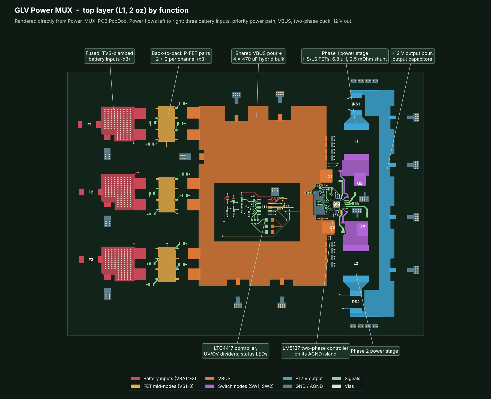
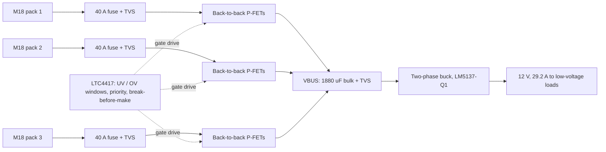
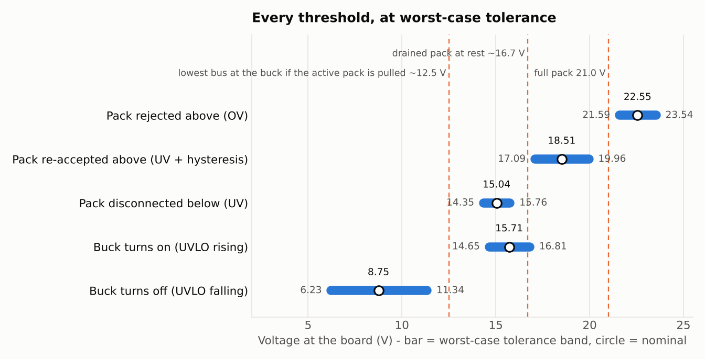
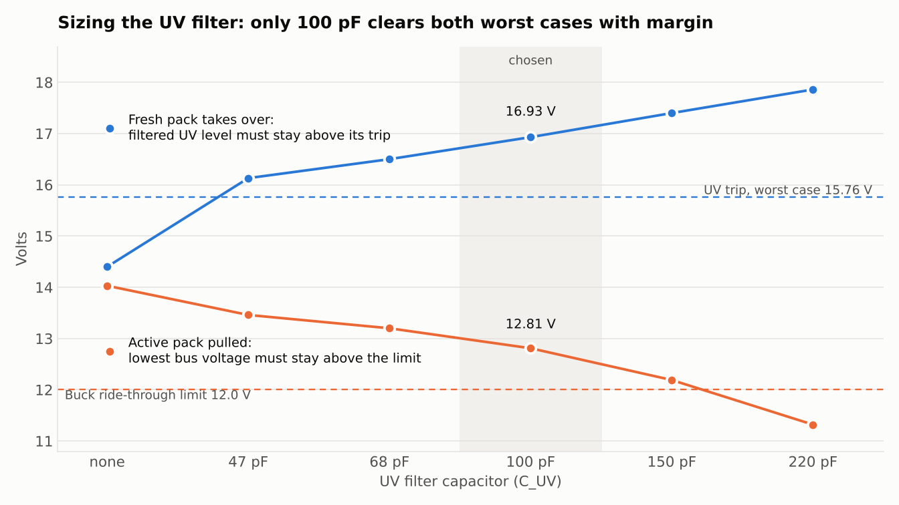
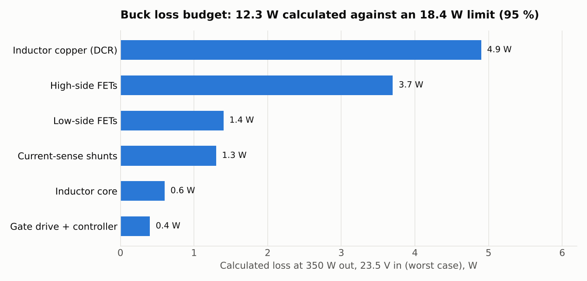
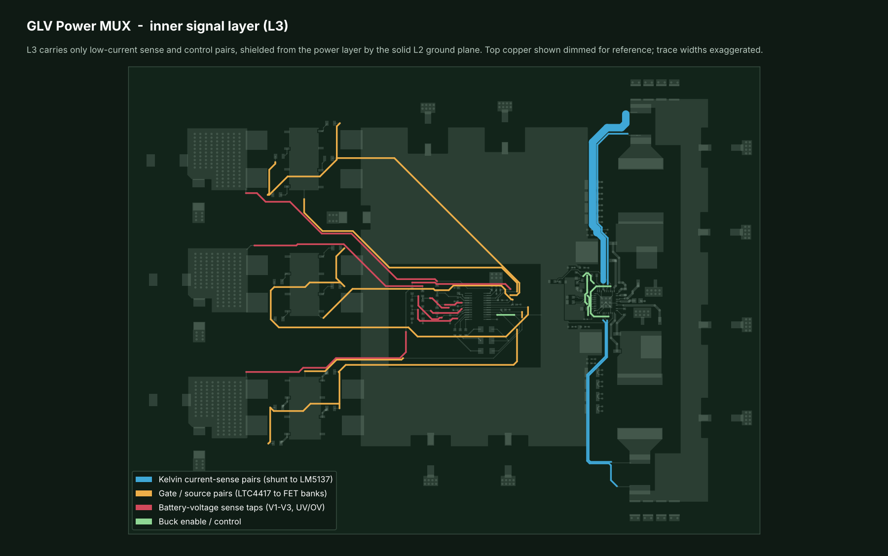

# GLV Power MUX

**Three hot-swappable tool batteries in, one regulated 12 V / 350 W rail out, for a Formula SAE electric car's low-voltage system.**

A priority power path (LTC4417) drains three Milwaukee M18 packs one at a time, and a custom two-phase synchronous buck (LM5137-Q1) turns the 15–21 V battery bus into 12 V at up to 29.2 A. Designed solo in Altium Designer: architecture, part selection, worst-case analysis, schematic and 4-layer layout.

> **Status: Rev A design complete. Bench validation pending.**
> No hardware has been tested yet. Every performance number on this page is **calculated** from datasheet worst-case values, and each one is paired with the bench test that will confirm it ([validation plan](docs/validation-plan.md)).



## At a glance

| | |
|---|---|
| Input | 3 × Milwaukee M18 5 Ah (5S Li-ion), 15.0–21.0 V, one pack at a time in priority order |
| Output | 12 V ±5 %, 29.2 A continuous (350 W) |
| Power path | LTC4417 controller, 12 × Toshiba TJ90S04M3L P-FETs (back-to-back, two in parallel per side), 40 A fuse and 1500 W TVS on every input |
| Bus storage | 4 × 470 µF hybrid polymer capacitors (1880 µF) |
| Converter | TI LM5137-Q1, two-phase interleaved, 202.6 kHz, 6.8 µH per phase, shunt current sensing |
| Efficiency | ≥ 95 % required, ≈ 96 % calculated at worst case |
| Runtime | ≥ 30 min required, ≈ 33 min calculated on three packs |
| PCB | 4 layers, 2 oz outer copper, solid ground plane on L2, about 115 parts |
| Tools | Altium Designer, Python (tolerance corner sweeps and a time-step switchover model) |

## The problem

The car's low-voltage system used to be fed through diode-OR'd packs. Diodes waste about 11 W at this current, let packs at different charge levels share load unpredictably, and give the driver no way to know which pack to swap. The requirements for the replacement:

- Drain **one pack at a time**, in a fixed order, with no current ever flowing between packs.
- Allow idle packs to be swapped while the car is running.
- Cut each pack off at 15.0 V under load, and never reconnect a drained pack when its voltage recovers at rest.
- Hold 12 V ±5 % at 350 W for **at least 30 minutes**, with buck efficiency of at least 95 %.
- Keep heat low enough to run without a heatsink, using inexpensive parts.

## Architecture



The LTC4417 connects the highest-priority pack whose voltage sits inside its under/over-voltage window, and stays on it until that pack hits its cutoff. It then opens that channel, waits a couple of microseconds, and closes the next one. The bulk capacitors carry the load across the gap. Because the buck is a constant-power load, pack current rises as the pack drains (17.5 A fresh, 25.6 A at cutoff), which drives most of the worst-case numbers below.

## Design decisions

| Decision | Alternatives considered | Why |
|---|---|---|
| Priority switching with back-to-back FETs | Diode-OR, paralleling packs | About 4.3 W of path loss instead of ~11 W, no pack-to-pack current, and reverse-polarity blocking for free |
| Two P-FETs in parallel on each side of each channel | One FET per side, one larger FET, clip-on heatsinks | One FET would dissipate ~6.5 W and run away thermally. Two share it at ~1.6 W each and stay near 115 °C on copper alone |
| 15 V cutoff measured under load, with 3.5 V of hysteresis | Higher cutoff, default 30 mV hysteresis | A loaded 15 V is about 3.36 V per cell at rest, safe for the cells. A higher cutoff would strand 10–15 % of each pack and miss the runtime target. The hysteresis keeps a rested pack from reconnecting |
| SMCJ22CA input clamps | The SMBJ26CA shown in the controller's datasheet | The datasheet example interrupts ~2 A. This board interrupts ~26 A at every pack change, where the smaller part clamps near 50 V against a 42 V pin rating |
| 100 pF filter on each UV pin | No filter, larger filter, a slew-rate network, input bulk capacitors | The only value that survives both a fresh pack taking over and the active pack being pulled out ([chart](#engineering-highlights)) |
| 4 × 470 µF hybrid capacitors | One 2000 µF electrolytic | Shares the ripple current across four parts, a quarter of the ESR, survives vibration, still works with one failed open |
| Two-phase buck with a 100 % duty controller | Single phase, an off-the-shelf module | Halves the per-phase current and the input ripple. 100 % duty matters because 12 V out of a 13.5 V bus needs a duty cycle of 0.94 |
| Shunt current sensing | Inductor DCR sensing | Current limit spread of 21.3–26.7 A instead of 15.5–26.4 A, which would trip at full load when hot |
| 4 layers, solid ground on L2 | 2 layers | The switching loop returns directly under the top layer, which keeps the hot-loop inductance low enough for 40 V FETs |

The full reasoning, including the options that were rejected and the mistakes caught along the way, is in [docs/design-decisions.md](docs/design-decisions.md).

## Engineering highlights

**Every threshold is designed at worst-case tolerance, not nominal.** Resistor tolerance, comparator accuracy and pin leakage are stacked for each trip point. The bands may not overlap the events they have to separate: a full pack must never be rejected, a rested drained pack must never be re-accepted, and the buck must stay on through a pack change.



**The UV filter capacitor has a narrow window.** Too small, and the 82 A inrush into the bus when a fresh pack takes over dips its own sense pin below the cutoff. Too large, and the controller reacts too slowly when the active pack is pulled, so the bus falls below what the buck can ride through.



**The loss budget closes with margin.** The 95 % requirement allows 18.4 W of loss at full load.



*The two FET rows were computed for the 5 × 6 mm FET used before the design review (3.5 mΩ max at 4.5 V gate drive). The TO-252 part that replaced it has a comparable on-resistance (2.6 mΩ typical at 4.5 V), so the budget is expected to hold. Measured efficiency will replace this chart.*

All of the math, with formulas, source values and results, is in [docs/calculations.md](docs/calculations.md).

## PCB

- **Stackup:** 2 oz top, 2.8 mil prepreg, 0.5 oz ground plane, 48 mil core, 0.5 oz signal layer, 2.8 mil prepreg, 2 oz bottom.
- **Power stays on the outer layers.** Each battery input, each FET mid-node, the shared VBUS bus and the 12 V output is a single-net pour. Via arrays under every FET drain tab carry heat and current through the board.
- **The switching loop is closed locally.** Each phase has four 10 nF capacitors at the high-side drain, backed by four 10 µF capacitors, returning through the L2 plane.
- **Sensing is Kelvin and shielded.** Current-sense pairs and gate/source pairs run on L3 under the ground plane, away from the switch nodes.
- **Analog ground is an island** tied to power ground at one point under the controller.



Details: [docs/pcb-layout.md](docs/pcb-layout.md)

## Design review

The schematic and layout were reviewed by practicing engineers from industry. The most significant change was replacing the buck FETs with a single-pad TO-252 part to simplify the high-current routing. The review notes, the failure-mode table and the list of known limitations are in [docs/design-review.md](docs/design-review.md).

## Validation status

| Quantity | Requirement | Calculated | Measured |
|---|---|---|---|
| Runtime on three packs | ≥ 30 min | ≈ 33 min | pending |
| Buck efficiency at 350 W | ≥ 95 % | ≈ 96 % worst case | pending |
| Output voltage | 11.4–12.6 V | 11.82–12.18 V | pending |
| Bus dip during a pack change | buck stays in regulation | 0.33 V worst case | pending |
| Input pin peak at a pack change | ≤ 42 V | ≈ 32 V | pending |
| Power-path FET junction | ≤ 125 °C | 115 °C worst case | pending |
| Buck high-side FET junction | ≤ 150 °C | ≈ 126 °C plus heating from the inductor (estimate from the pre-review FET) | pending |

Test procedures and pass criteria: [docs/validation-plan.md](docs/validation-plan.md)

## Repository

```
README.md               this page
docs/
  design-decisions.md   options considered, choices made, mistakes caught
  calculations.md       worst-case math for every block
  pcb-layout.md         stackup, layer plan, layout rules
  design-review.md      review findings, failure modes, known limitations
  validation-plan.md    bench tests and pass criteria
hardware/
  altium/               Altium Designer project (schematics, PCB, libraries)
  bom.csv               bill of materials generated from the schematics
images/                 figures used in these pages
```

## Author

[general-spooky](https://github.com/general-spooky)
