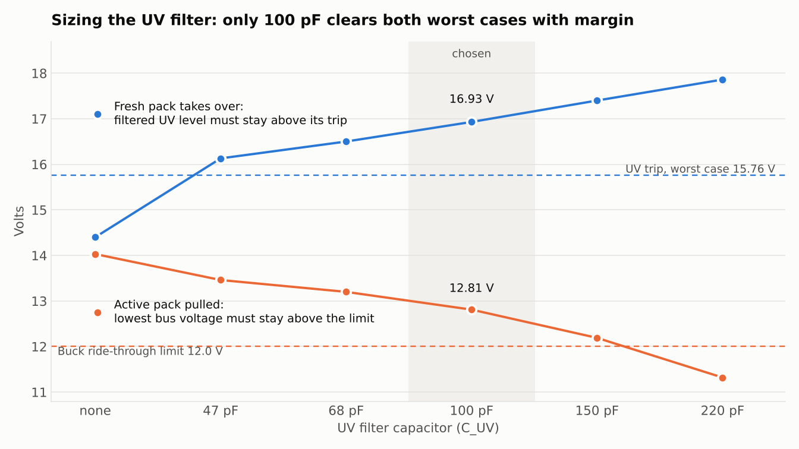
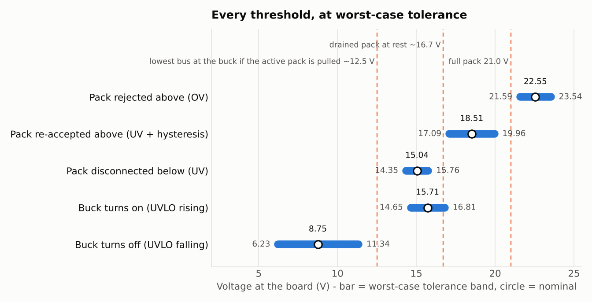
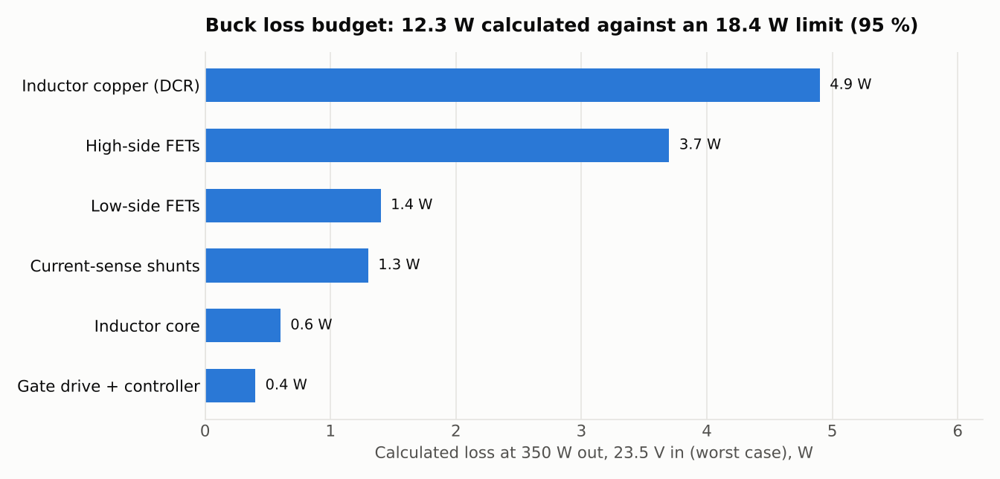

# Calculations

Worst-case design math for each block. Every result here is **calculated**; none is measured yet. Each section follows the same order: formula, values and where they come from, result, and what the result means for the circuit.

Values marked *(assumed)* are engineering assumptions, not datasheet figures. They are collected in the [assumptions register](#assumptions-register) and are the first things the bench tests check.

Contents: [Load](#1-load-and-battery) · [UV/OV divider](#2-uvov-divider) · [Hysteresis](#3-hysteresis) · [Lowest bus voltage](#4-lowest-bus-voltage) · [Power-path FETs](#5-power-path-fet-thermals) · [Bulk capacitors](#6-bulk-capacitors) · [UV filter](#7-uv-filter-capacitor) · [Input TVS](#8-input-tvs) · [Buck UVLO](#9-buck-enable-thresholds) · [Buck power stage](#10-buck-power-stage) · [Loss budget](#11-buck-loss-budget) · [Runtime](#12-runtime)

---

## 1. Load and battery

```math
V_{full} = 5 \times 4.20 = 21.0\ \text{V} \qquad I_{out} = \frac{350}{12} = 29.2\ \text{A} \qquad P_{in} = \frac{350}{0.95} = 368\ \text{W}
```

The buck is a constant-power load, so the current drawn from the pack rises as its voltage falls:

```math
I_{in} = \frac{P_{in}}{V_{bus}}
```

| Bus voltage | When | Pack current |
|---|---|---|
| 21.0 V | fresh pack | 17.5 A |
| 18.0 V | mid-discharge | 20.4 A |
| 14.4 V | end of pack, at the buck input | 25.6 A |
| 13.74 V | lowest possible bus, all tolerances stacked | 26.8 A |

**What it means:** the worst electrical stress on the power path happens at the *end* of each pack, not the beginning. Thermal and droop checks use 25.6–26.8 A.

## 2. UV/OV divider

One resistor string per input with two taps: battery → R_top → UV pin → R_mid → OV pin → R_bot → ground. The LTC4417 comparators trip at 1.000 V ±1.5 %.

```math
V_{UV} = \frac{R_{top}+R_{mid}+R_{bot}}{R_{mid}+R_{bot}} \qquad V_{OV} = \frac{R_{top}+R_{mid}+R_{bot}}{R_{bot}}
```

Pin leakage (±20 nA max) shifts each threshold by the leakage times the resistance above the tap:

```math
\Delta V_{UV} = I_{leak} R_{top} \qquad \Delta V_{OV} = I_{leak}(R_{top}+R_{mid})
```

| Value | Number | Source |
|---|---|---|
| R_top / R_mid / R_bot | 10 MΩ / 237 kΩ / 475 kΩ, 1 % | schematic |
| Comparator threshold | 0.985–1.015 V | LTC4417 datasheet |
| Pin leakage | ±20 nA | LTC4417 datasheet |

| Threshold | Nominal | Worst-case band | Must satisfy |
|---|---|---|---|
| UV (pack disconnect) | 15.04 V | 14.35–15.76 V | around the 15.0 V pack minimum |
| OV (pack reject) | 22.55 V | 21.59–23.54 V | low end above a full 21.0 V pack |

**What it means:** an earlier divider (226 kΩ / 487 kΩ) passed at nominal but its worst-case OV trip was 21.06 V once leakage was included, close enough to reject a fully charged pack. The final values leave 0.59 V. The upper end of the OV band, 23.54 V, is what sets the buck's maximum operating input.

## 3. Hysteresis

A drained pack recovers about 2 V when the load is removed. Without enough hysteresis it would be re-accepted, sag, be rejected again, and oscillate.

```math
I_{HYS} = \frac{63\ \text{mV}}{R_{HYS}} \qquad \Delta V_{UV} = I_{HYS} R_{top} \qquad V_{re\text{-}enable} = V_{UV} + \Delta V_{UV}
```

| R_HYS | I_HYS | Hysteresis | Re-enable, nominal | Re-enable, worst case | Rested pack at ~16.7 V |
|---|---|---|---|---|---|
| 316 kΩ (first choice) | 199 nA | 1.99 V | 17.04 V | 15.83–18.28 V | can reconnect |
| **182 kΩ (final)** | 346 nA | 3.46 V | 18.51 V | 17.09–19.96 V | stays out, 0.39 V margin |

**What it means:** the first value looked fine at nominal and failed at the low corner. The cost of the final value is that a pack must be above 20.0 V to be *guaranteed* accepted, so packs should be swapped in charged.

## 4. Lowest bus voltage

During a pack change both channels are off for a short gap and the bulk capacitors supply the load.

```math
V_{bus,min} = V_{UV,low} - I R_{FET,hot} - \frac{I\, t_{gap}}{C_L} - I \cdot ESR_{bank}
```

| Value | Number | Source |
|---|---|---|
| Fault filter + break-before-make | 13 µs + 3.2 µs max | LTC4417 datasheet |
| Extra gate delay | 2.1 µs | gate load is 4 × 7.7 nF, three times the datasheet test load *(assumed scaling)* |
| t_gap | 18.3 µs | sum |
| C_L | 1880 µF, 1504 µF at −20 % | 4 × Panasonic EEH-ZU1V471V |

| Case | Bus at trip | Droop | Lowest bus | At the buck input |
|---|---|---|---|---|
| Nominal | 14.82 V | 0.13 V | 14.63 V | 14.4 V |
| Worst | 14.12 V | 0.33 V | 13.74 V | 13.5 V |

**What it means:** the buck must regulate from 13.5 V, well below the 15 V pack cutoff. At 13.5 V in and 12 V out the duty cycle is about 0.94, which is why the controller had to support near-100 % duty.

## 5. Power-path FET thermals

Each channel has two FETs in parallel on the battery side and two on the bus side.

```math
P_{FET} = \left(\frac{I}{2}\right)^2 R_{hot} \qquad T_J = T_A + P\,R_{\theta JA}
```

| Value | Number | Source |
|---|---|---|
| R_DS(on) at −4.5 V | 6.0 mΩ max | TJ90S04M3L datasheet |
| Hot factor | × 1.5 → 9.0 mΩ | *(assumed)* |
| R_θJA on this board | 40 °C/W | *(assumed)*: about 11 cm² of 2 oz copper per FET plus vias |
| Ambient | 50 °C | *(assumed)* |

| Operating point | Current | Loss per FET | Junction | Whole path |
|---|---|---|---|---|
| RMS over a pack | 21.8 A | 1.07 W | ≈ 93 °C | 4.3 W |
| End of pack | 25.6 A | 1.47 W | 109 °C | 5.9 W |
| Worst case | 26.8 A | 1.62 W | 115 °C | 6.5 W |

Why not one FET per side: it would carry the full current and dissipate 26.8² × 9.0 mΩ = 6.5 W, far above what board copper can remove. The largest current one FET can carry for a 125 °C junction is

```math
I_{max} = \sqrt{\frac{(125-50)/40}{0.009}} = 14.4\ \text{A} \qquad N = \frac{26.8}{14.4} = 1.86 \rightarrow 2
```

The gate drive matters here: the LTC4417 only guarantees 4.5 V of gate-source drive, so FETs are compared by R_DS(on) at 4.5 V, not by their headline current rating. Each gate has its own 10 Ω resistor, which is above the critical damping value for the gate loop (2√(10 nH / 7.7 nF) = 2.3 Ω) and stops the paralleled FETs from oscillating against each other.

**What it means:** two FETs per side at 1.6 W each stay under 125 °C on copper alone. The 40 °C/W figure is the largest unknown: 10 °C/W more adds 16 °C.

## 6. Bulk capacitors

```math
C_{min} = \frac{I\, t_{gap}}{\Delta V} = \frac{26.8 \times 18.3\ \mu\text{s}}{0.5\ \text{V}} = 981\ \mu\text{F} \quad\rightarrow\quad \frac{981}{0.8} = 1226\ \mu\text{F with tolerance}
```

Installed: 1880 µF.

| Check | Result |
|---|---|
| Droop at a pack change | 0.26 V nominal, 0.33 V worst |
| Ripple current, two-phase worst case (D = 0.75) | 7.3 A total, 1.8 A per capacitor against a 5.5 A rating |
| Voltage | 23.54 V of 35 V (67 %) |
| One capacitor fails open | droop rises to 0.35 V, still works |

**What it means:** four 470 µF hybrids were chosen over a single large electrolytic because one can would carry all of the ripple, at several times its rating, and tall cans are fragile under vibration.

## 7. UV filter capacitor

When a fresh pack takes over, it charges the bus through its own source resistance:

```math
I_{inrush} = \frac{21 - 13.72}{0.080 + 0.006 + 0.00225} \approx 82\ \text{A} \qquad V_{pin} = 21 - 82 \times 0.080 = 14.4\ \text{V}
```

That dip lasts about 166 µs (1880 µF × 88 mΩ), far longer than the controller's 8 µs fault filter. Without filtering, the new pack would trip its own under-voltage comparator and the bus would collapse while it re-validates for 256 ms. An RC filter on the UV pin fixes this, with time constant

```math
\tau_{UV} = (R_{top} \parallel (R_{mid}+R_{bot}))\, C_{UV} = 665\ \text{k}\Omega \times C_{UV}
```

But the same filter delays the controller when the active pack is pulled out, and the bus falls at about 17.8 V/ms while it waits.

| C_UV | τ | Fresh pack takes over: filtered level (needs > 15.76 V) | Active pack pulled: lowest bus (needs ≥ 12.0 V) |
|---|---|---|---|
| none | — | 14.40 V, fails | 14.03 V |
| 47 pF | 31 µs | 16.13 V, thin | 13.46 V |
| 68 pF | 45 µs | 16.50 V | 13.20 V |
| **100 pF** | **66 µs** | **16.93 V, 1.17 V margin** | **12.81 V** |
| 150 pF | 100 µs | 17.40 V | 12.19 V |
| 220 pF | 146 µs | 17.86 V | 11.32 V, fails |



**What it means:** the first value tried (tens of nanofarads) was wrong by more than two orders of magnitude; it would have let the bus collapse on pack removal. The table comes from a time-step model with a constant-power load at worst-case corners.

## 8. Input TVS

Three checks, all required: standoff voltage above the normal voltage, clamp voltage **at the actual current** below the protected pin's absolute maximum, and energy within rating.

```math
V_{clamp}(I) \approx V_{BR,max} + I\,\frac{V_C - V_{BR,max}}{I_{PP}} \qquad E = \tfrac{1}{2} L I^2 = \tfrac{1}{2}(1\ \mu\text{H})(25.6\ \text{A})^2 = 0.33\ \text{mJ}
```

| Part | Clamp at 25.6 A | LTC4417 input pin limit (42 V) |
|---|---|---|
| SMBJ26CA (datasheet example) | ≈ 50 V | exceeded |
| SMBJ22CA | ≈ 40 V | marginal |
| **SMCJ22CA** | **≈ 32 V** | passes |

**What it means:** at every pack change the FETs interrupt about 25 A in about a microsecond, and the battery cable's inductance *(assumed 1 µH)* kicks the input pin. The part copied from the datasheet figure is correct for that figure's 2 A, and wrong here. Checking energy alone (0.33 mJ against a rating of hundreds of millijoules) would not have caught it.

## 9. Buck enable thresholds

The two LM5137 enable pins are tied to one divider from VBUS (309 kΩ / 21.0 kΩ).

```math
V_{on} = V_{EN(on)}\left(1+\frac{R_{UV1}}{R_{UV2}}\right) = 1.00\left(1+\frac{309}{21.0}\right) = 15.71\ \text{V}
```

```math
V_{off} = \left(V_{EN(off)} - I_{HYS}\,(R_{UV1}\parallel R_{UV2})\right)\frac{R_{UV1}+R_{UV2}}{R_{UV2}} = 8.75\ \text{V}
```

| Threshold | Nominal | Worst-case band | Limit |
|---|---|---|---|
| Turn-on | 15.71 V | 14.65–16.81 V | below the lowest accepted pack, 17.09 V |
| Turn-off | 8.75 V | 6.23–11.34 V | below the bus dip on pack removal, about 12.5 V at the buck |



**What it means:** the buck starts only after a valid pack is connected and stays on through the worst pack-change dip. A 20 ms buck soft-start keeps the buck from loading the bus while the LTC4417 is still ramping it at 5 V/ms, which keeps the power-path FETs inside their safe operating area at power-up.

## 10. Buck power stage

**Switching frequency.** 115 kΩ on RT gives

```math
R_{RT}[\text{k}\Omega] = \frac{10^6/F_{SW}[\text{kHz}] - 15}{42.8} \quad\Rightarrow\quad F_{SW} = 202.6\ \text{kHz}
```

**Inductor.** The controller's slope compensation fixes the ideal inductance for a given shunt:

```math
L_{ideal}[\mu\text{H}] = \frac{V_{OUT}\cdot R_S[\text{m}\Omega]}{22\cdot F_{SW}[\text{MHz}]} = \frac{12 \times 2.5}{22 \times 0.2026} = 6.73\ \mu\text{H} \rightarrow 6.8\ \mu\text{H}
```

**Current limit.** The sense threshold is 54–66 mV across a 2.5 mΩ ±1 % shunt.

| Quantity | Value |
|---|---|
| Per-phase load current | 14.6 A |
| Worst phase DC (sharing mismatch and shunt tolerance) | 16.2 A |
| Worst ripple (inductance −20 % and roll-off at current, frequency −10 %, 23.54 V in) | 6.59 A |
| Worst operating peak | 19.5 A |
| Current limit band | 21.3–26.7 A |
| Margin, lowest limit over worst peak | 9 % |
| Short-circuit peak against inductor saturation | 27.0 A against 32 A |
| Slope-compensation ratio (needs ≥ 0.5) | 0.73 worst case |

**Bootstrap capacitors.** Sized from gate charge for 100–200 mV of sag per cycle: 0.47 µF.

**What it means:** the shunt value is a compromise. A larger shunt wastes more power and drops the minimum current limit below the worst operating peak; a smaller one raises the short-circuit peak toward inductor saturation. 2.5 mΩ sits between the two with about 9 % margin on one side and 15 % on the other.

## 11. Buck loss budget

The 95 % requirement allows 350/0.95 − 350 = 18.4 W.

| Loss, worst case at 23.54 V in | Watts | Basis |
|---|---|---|
| Inductor copper | 4.9 | 2 × (14.6 A)² × 8.83 mΩ max × 1.3 hot |
| High-side FETs | 3.7 | conduction and switching |
| Low-side FETs | 1.4 | conduction and dead-time diode |
| Current-sense shunts | 1.3 | 2 × (16.1 A)² × 2.5 mΩ, worst phase |
| Inductor core | 0.6 | *(assumed)* ≤ 0.3 W per phase |
| Gate drive and controller | 0.4 | gate charge × frequency, supplied from the 12 V output |
| **Total** | **12.3** | **η ≈ 96.4 %** |



The FET rows were computed for the 5 × 6 mm FET in the design before the review (3.5 mΩ max at 4.5 V, 31 nC typical gate charge). The TO-252 FET that replaced it has comparable figures (2.6 mΩ and 28 nC typical at 4.5 V), so these rows are carried over as estimates until measured efficiency replaces the table.

**What it means:** about 6 W of the 18.4 W allowance is unspent. The largest single loss is inductor copper, a deliberate trade: the chosen inductor holds its inductance better at high current than the lower-resistance alternative.

## 12. Runtime

```math
P_{pack} = 368 + 4.2 + 4.7 + 0.9 = 378\ \text{W} \qquad t = \frac{3 \times 70\ \text{Wh}}{378\ \text{W}} = 33.3\ \text{min}
```

The terms after the buck's 368 W are FET loss, wiring loss and fuse loss.

| Usable energy per pack at ~25 A | 70 Wh *(assumed)* | 65 Wh | 63 Wh |
|---|---|---|---|
| Runtime | 33.3 min | 31.0 min | 30.0 min |

**What it means:** the hard requirement passes only if each pack delivers at least about 63 Wh at this current. That number is assumed, which makes the pack discharge test the first test in the validation plan.

---

## Assumptions register

| Assumption | Value | Used in |
|---|---|---|
| Pack internal resistance | 70 mΩ | sag, inrush, rest voltage |
| Pack wiring to the board | 10 mΩ | inrush |
| Usable energy per pack | 70 Wh of 90 Wh nominal | runtime |
| FET on-resistance hot factor | × 1.5 | thermals |
| FET junction-to-ambient on this board | 40 °C/W | thermals |
| Ambient | 50 °C | thermals |
| Battery cable inductance | 1 µH | TVS clamp |
| Extra gate delay from the larger gate load | 2.1 µs | bus droop |
| Hysteresis current tolerance at 346 nA | ±20 % | re-enable band |
| Oscillator tolerance at 200 kHz | ±10 % | ripple, current limit |
| Inductor core loss | ≤ 0.3 W per phase | loss budget |
| Inductor-to-FET thermal coupling | 3–10 °C per watt in the inductor | high-side FET temperature |
