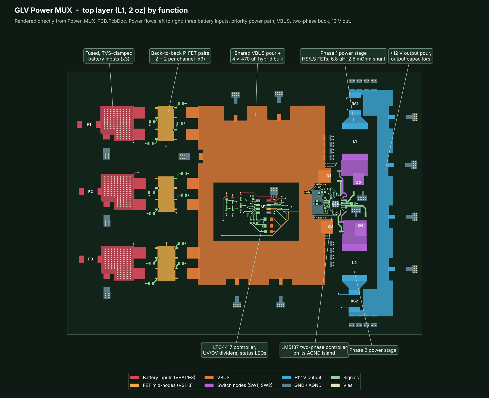

# PCB layout

The board is a 4-layer design in Altium Designer. The figures on this page are rendered directly from `hardware/altium/Power_MUX_PCB.PcbDoc`.

## Stackup

| Layer | Copper | Dielectric below | Role |
|---|---|---|---|
| L1 top | 2 oz (2.76 mil) | 2.8 mil prepreg | All components and all high-current pours |
| L2 | 0.5 oz | 48.4 mil core | Solid ground plane, no routing |
| L3 | 0.5 oz | 2.8 mil prepreg | Low-current sense and control pairs |
| L4 bottom | 2 oz (2.76 mil) | — | Assigned to duplicate high-current copper and ground fill |

Finished thickness is about 1.55 mm. All vias are through-hole, 0.6 mm pad with a 0.3 mm drill.

**Why this stackup:** the thin prepreg puts the ground plane 2.8 mil under the top layer, so switching current returns directly beneath its forward path and the hot-loop inductance stays low. The two heavy layers are the outer ones, where they can carry current and shed heat to air. The inner layers carry no significant current, so 0.5 oz is sufficient.

## Floorplan

Power flows left to right in a straight line, which keeps every high-current path short and avoids crossing power over signals:

1. **Battery inputs** on the left edge: fuse, then TVS, then the battery-side FET drains.
2. **Power-path FETs:** each channel is two battery-side FETs, a small mid-node pour, and two bus-side FETs.
3. **VBUS:** one pour spanning all three channels, with the four bulk capacitors on its edges. Sharing one pour is possible because only one channel conducts at a time.
4. **LTC4417 and its dividers** sit in a quiet window cut out of the centre of the VBUS pour, with a tight local ground.
5. **Buck converter** on the right: controller in the middle, one phase above and one below, mirrored.
6. **12 V output** pour down the right side, collecting both phases after their shunts.

## Power path

- **Pours stay within one net.** The battery-side FET pair of each channel shares a VBATn pour, and all bus-side pairs share VBUS. The four FETs of a channel cannot share copper because their drains are different nets.
- **Via arrays in each battery-input pour** (about 116 per channel) stitch it through the board for current sharing and heat spreading.
- **Power pads connect directly to their pours** with no thermal-relief spokes, which would choke both current and heat. Small signal parts keep spokes so they can be soldered.
- **Each gate has its own 10 Ω resistor at the gate lead.** The gate and source-sense lines of each channel return to the controller as a pair on L3.
- **The 10 MΩ divider nodes are kept short** and clear of other copper, since leakage across the board surface would shift the thresholds.
- **TVS grounds drop straight to the plane** through their own via groups.

## Buck converter

- **Hot loop.** Each phase has four 10 nF 0402 capacitors directly at the high-side drain and four 10 µF 1210 capacitors behind them, all returning to L2 through vias beside their pads. This closes the high-frequency loop within a few millimetres.
- **Switch nodes are small and stay on L1.** No vias and no copper on other layers, to limit radiated noise and capacitive coupling into the plane.
- **Gate drives** are routed as pairs with their returns (HO with SW), 0.65 mm wide for the 2–3 A peaks.
- **Current sense is Kelvin.** Each sense pair leaves the inner edges of its shunt pads and runs as a tight pair on L3 back to the controller, shielded by the ground plane from the switch nodes above.
- **Analog ground island.** The timing, soft-start, configuration, compensation and feedback parts sit on their own AGND pour beside the controller, joined to power ground at a single net-tie under the exposed pad.
- **Thermal separation.** The inductors dissipate about 2.5 W each and sit next to the high-side FETs. Heat is steered in opposite directions: the FET drain copper extends away from the inductor, and the inductor's output-side pad carries the large pour toward the output.

## Design rules

| Rule | Value |
|---|---|
| Copper clearance | 0.2 mm |
| Minimum trace width | 0.2 mm |
| Gate-drive traces (buck) | 0.65 mm |
| Sense traces | 0.2 mm, routed as pairs |
| Via | 0.6 mm pad, 0.3 mm drill |
| Power pad connection | direct |

## Known layout compromises

Checked at bring-up.

| Item | Effect | Check |
|---|---|---|
| Switch-node copper necks to about 1 mm between the phase-1 FETs | Local warm spot, estimated under 0.1 W | Thermal image at full load |
| 10 µF input capacitors sit about 25 mm from the low-side source | Ripple is unaffected; some switch-node ringing is possible | Scope the switch node |
| The bias/sense trace to the controller is 1.5 mm wide on 0.5 oz copper | Controller supply current creates a small sense offset, costing about 3 % of current-limit margin | Current-limit test |
| Inductors close to the high-side FETs | Raises FET temperature by an estimated 8–28 °C | Thermocouples on FET, inductor and switch-node copper |
